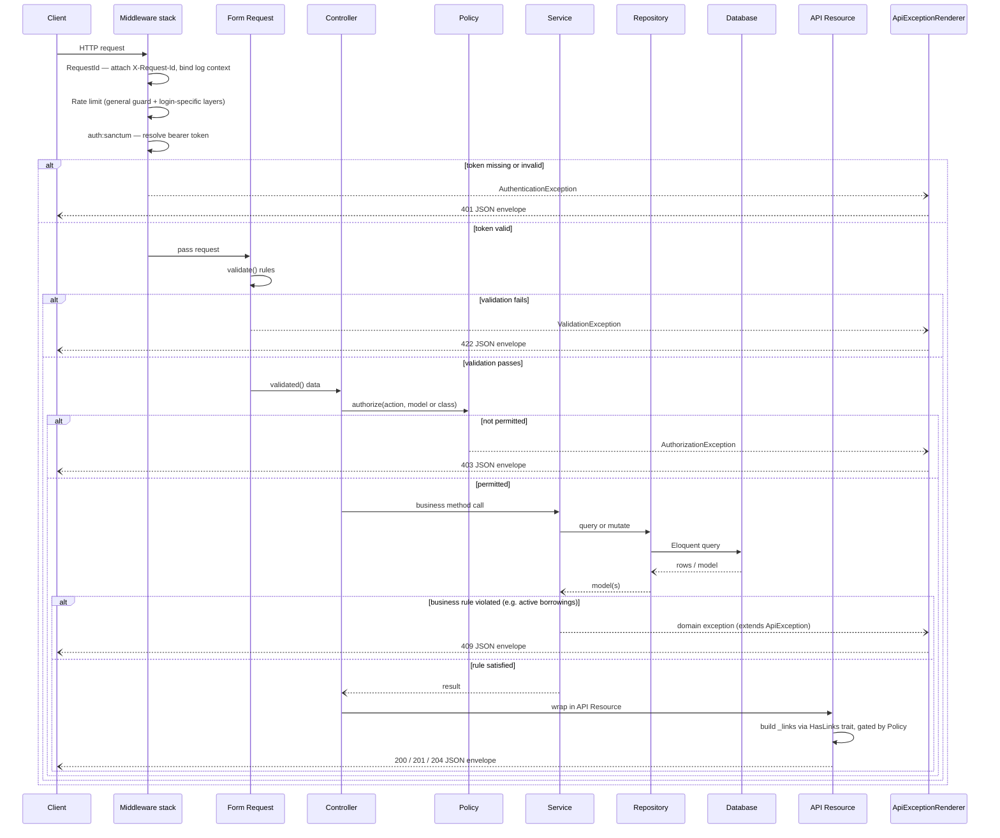
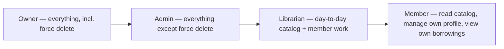

# Request flow & design patterns

How any request moves through the codebase, end to end, and which design patterns show up where.

## Request pipeline (applies to every endpoint)

## Role hierarchy

Each arrow means "this role's permitted actions are a subset of the one before it." The full action-by-action breakdown lives in the README's **Access control** tables — this diagram is a quick visual summary, not a replacement for them.

## Design patterns in this codebase

| Pattern | Where it shows up |
|---|---|
| **Repository pattern** | `MemberRepository` (and sibling repositories) — encapsulates every Eloquent query behind a narrow interface; Services never build queries directly |
| **Service layer** | `MemberService` and siblings — business rules, transactions, and orchestration live here; Controllers stay thin |
| **Policy-based authorization** | One Policy class per model, checked via `$this->authorize()` — Laravel's Gate system is effectively a Strategy pattern per action |
| **Form Request objects** | Validation rules isolated from controller bodies; `authorize()` can also live here as a first line of defense |
| **API Resource / transformer pattern** | `JsonResource` subclasses shape the wire format independently of the Eloquent model's raw attributes |
| **`HasLinks` trait** | A small mixin reused across every Resource for `_links` building, instead of duplicating link logic per Resource |
| **Global scope** | `Member` model's `member_role` scope — a reusable query filter applied automatically on every `Member::query()` call |
| **Centralized exception mapping** | `ApiException` as a common base; each domain exception (`MemberHasActiveBorrowingsException`, `MemberNotTrashedException`) only supplies a message/status/code; `ApiExceptionRenderer` is a single adapter translating any throwable into one consistent RFC 9457–style JSON shape |
| **Constructor property promotion + readonly** | `public function __construct(private readonly MemberRepository $memberRepository) {}` — PHP 8 idiom used throughout for dependency injection, resolved automatically by Laravel's service container |
| **Soft-delete state machine** | Not a classic GoF pattern by name, but effectively `active → trashed → {restored \| permanently deleted}`, enforced in the Service layer (the two-step safety gate) rather than left to ad-hoc controller checks |
| **Cache versioning** | `BookController`'s `cacheVersion()` / `flushBooksCache()` — a generation-counter pattern standing in for Redis/Memcached tag-based cache invalidation, which isn't available on the file/database cache driver |
