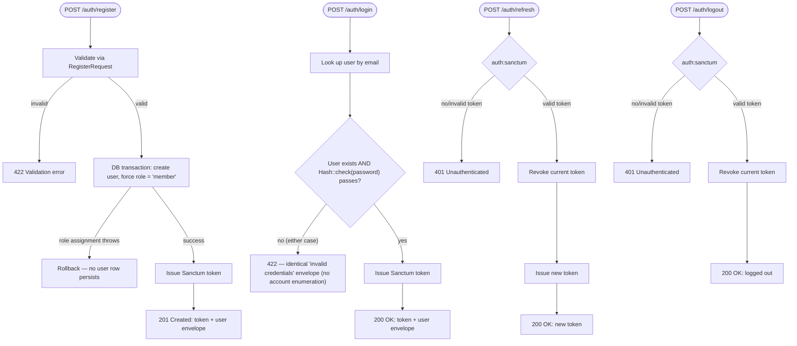

# Auth module flow

Covers `POST /auth/register`, `POST /auth/login`, `POST /auth/refresh`, `POST /auth/logout`.

> Verified against the current Pest suite (`AuthTest`) rather than an older copy of `AuthController` — if your controller doesn't yet wrap registration in a transaction or force the role server-side, that's a gap between this diagram and the code worth closing.

Key behaviors this diagram encodes:
- **No account enumeration** — a wrong password and an unknown email return the exact same response, so an attacker can't tell which one failed.
- **Role can't be set by the caller** — every new account is forced to `member` server-side, regardless of what the request sends.
- **Registration is transactional** — if role assignment fails for any reason, the whole operation rolls back; no orphaned user row is left behind.
