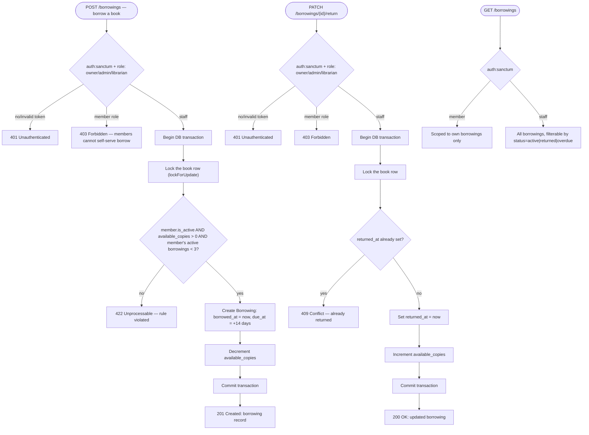

# Borrowings module flow

> **Unverified note:** this diagram is built from your project plan's stated business rules (section 6) and the README's access-control table — I haven't reviewed your actual `BorrowingController` / `BorrowingService` source in this conversation. Check this against the real implementation before treating it as documentation of fact rather than design intent.

The row lock on both borrow and return is what prevents two simultaneous requests from handing out (or double-crediting back) the same last copy — the concurrency guarantee your plan doc calls out explicitly.
