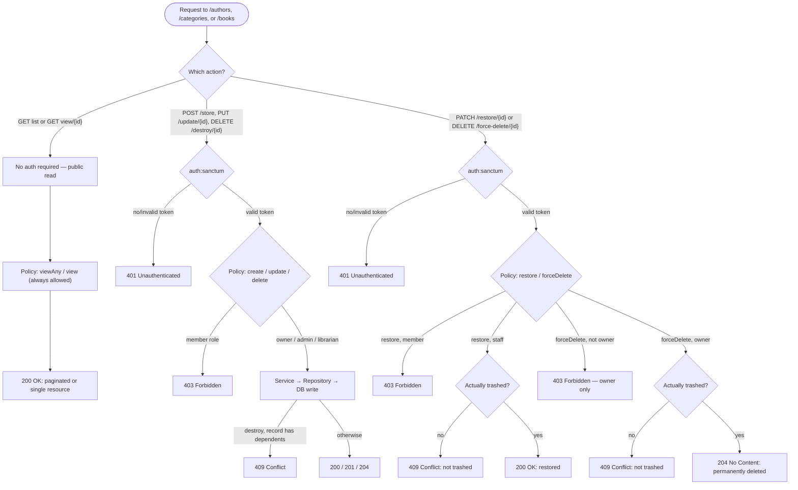

# Catalog module flow (Authors, Categories, Books)

These three modules share one pattern: public reads, staff-only writes, owner-only permanent deletion.

The `trashed` query parameter on the list endpoint (`only_deleted`, `with_deleted`) requires the same permission as the dedicated `/trashed` route — a member sending it gets `403`, not a silently-filtered result.
