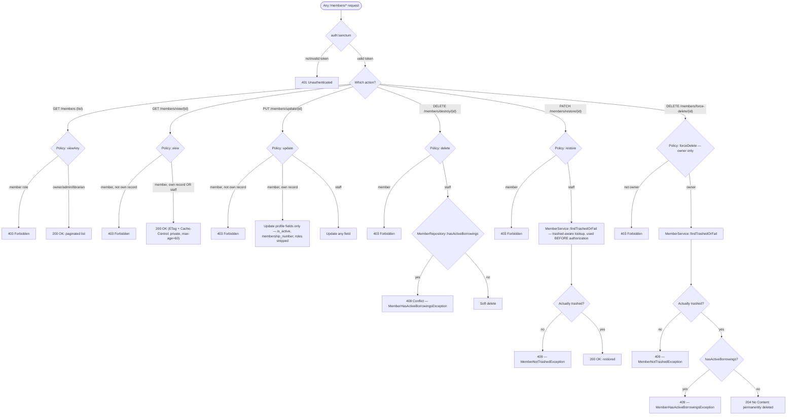

# Members module flow

Members are rows in `users` scoped to the `member` role (see `Member::booted()`'s global scope). Ownership checks (`own`) run through the Policy layer.

The `findTrashedOrFail` step on restore and force-delete is the fix for a real bug caught during development: the controller originally called the plain (non-trashed-aware) `findOrFail` before authorizing, which 404'd on any already-soft-deleted member — exactly the records these two actions are meant to operate on.
